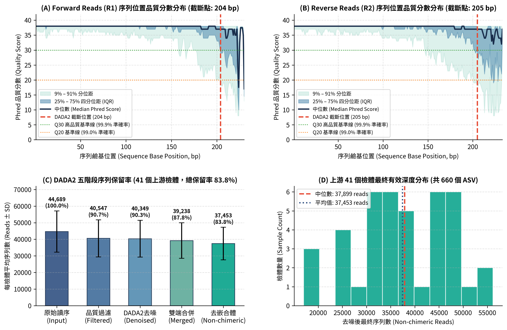
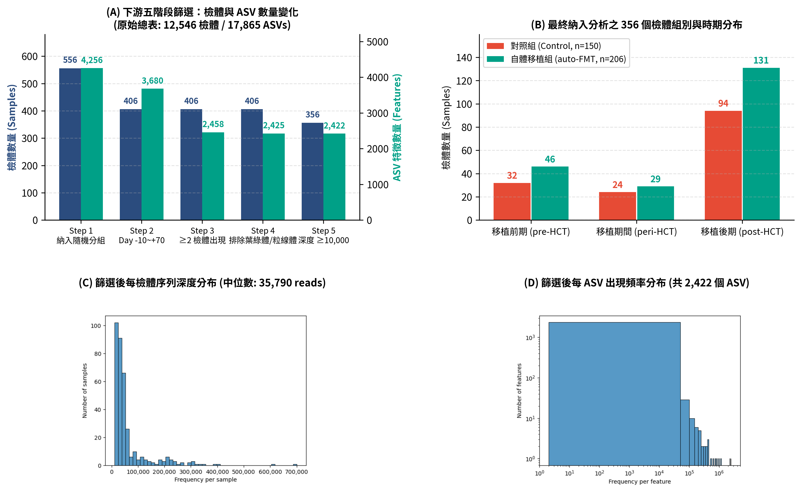
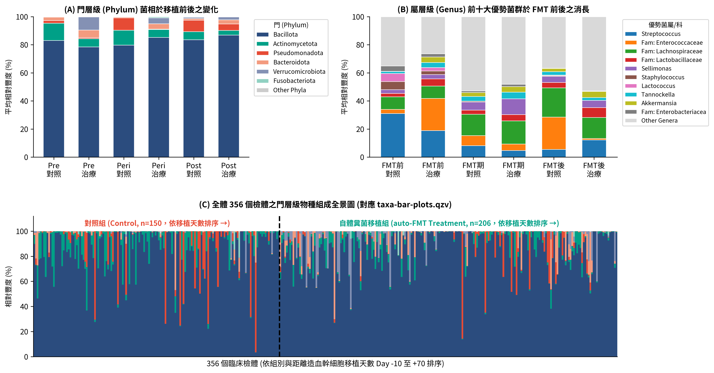
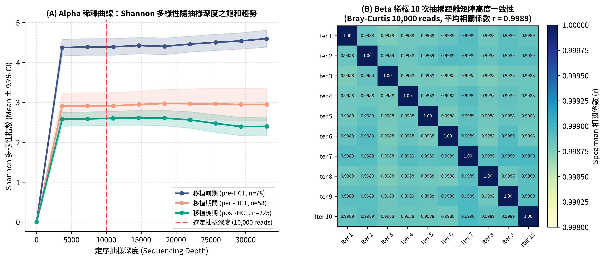
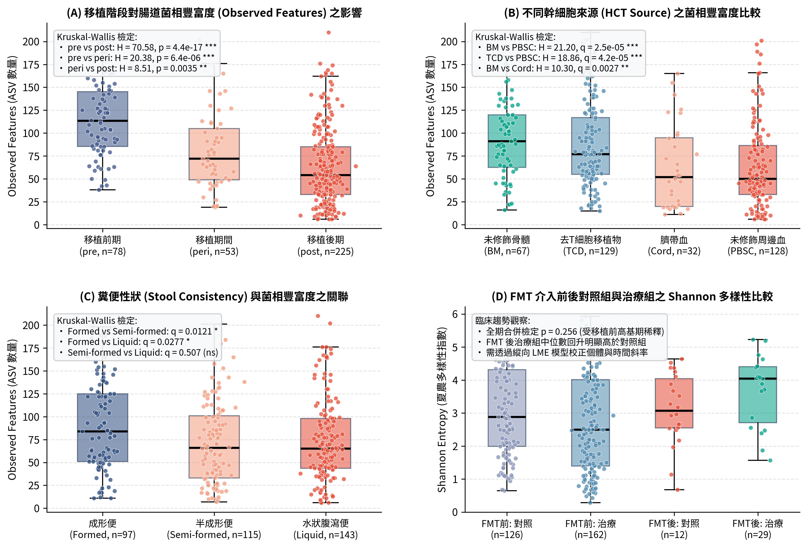
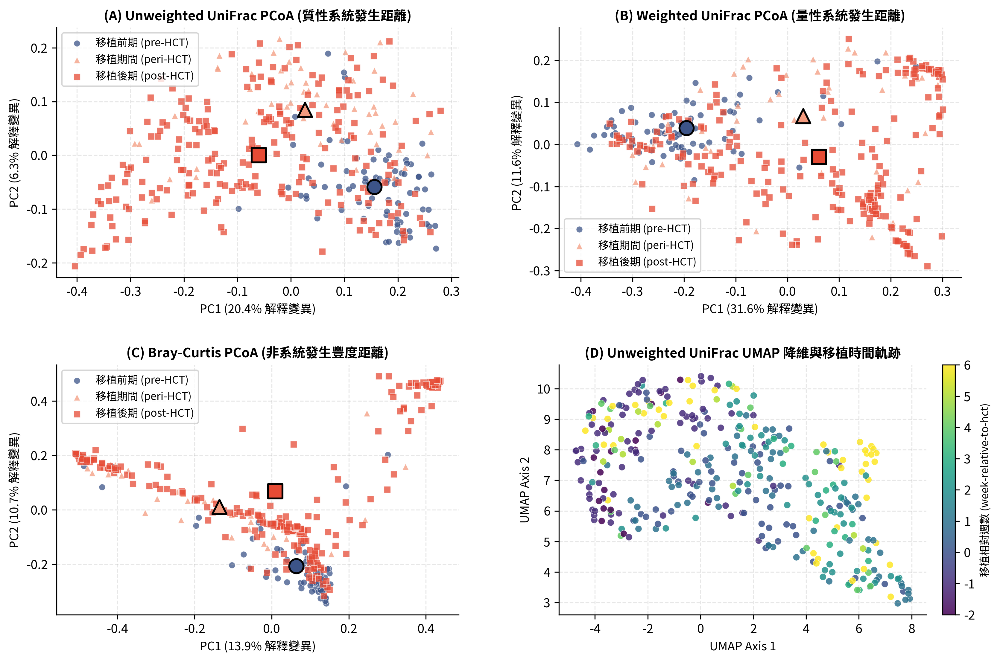
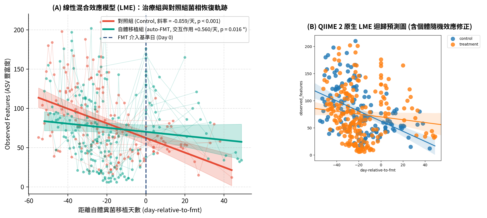
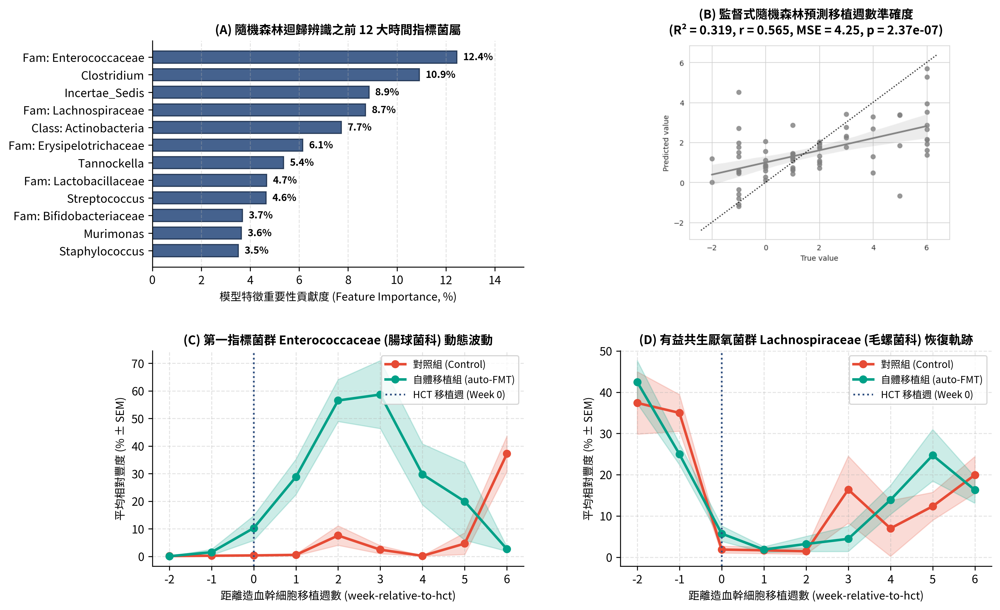

# Unit 05: QIIME 2 Gut Microbiome Analysis — Run a Complete Analysis on NCHC HPC Using Natural Language

> 🌐 **Language**: English | [繁體中文](README.zh-TW.md)

You have a batch of 16S sequencing data and want to run a gut microbiome analysis, but you're not familiar with Linux, Slurm, or QIIME 2 commands? This unit shows how to open an AI Agent on the HPC system of the NCHC (National Center for High-performance Computing) and, **with just a few plain-language sentences**, have it download the data, pick a project account, submit the job, report progress, and finally deliver a 9-page analysis report with 8 figures.

> 📥 **Unit Slides**: [Download 05-qiime2-analysis.en.pptx](https://github.com/gemini960114/ai-workshop-research/raw/main/PPTX/05-qiime2-analysis.en.pptx) (18 slides, with speaker notes; [Chinese version](https://github.com/gemini960114/ai-workshop-research/raw/main/PPTX/05-qiime2-analysis.pptx))

> 🎬 **Tutorial Video**: [Unit 05 | QIIME 2 Gut Microbiome Analysis](https://github.com/gemini960114/ai-workshop-research/blob/main/movies/05-qiime2-analysis.en.mp4) (MP4, 4 min 51 sec, English narration with [English subtitles](https://github.com/gemini960114/ai-workshop-research/blob/main/movies/05-qiime2-analysis.en.srt); [Chinese version](https://github.com/gemini960114/ai-workshop-research/blob/main/movies/05-qiime2-analysis.mp4))

**Download data → Confirm account and queue → Submit job → Generate report**

This unit has two focal points: the first half shows "how to ask AI to do work on HPC," which is quick; the second half looks at "what's in the analysis report," which becomes the material for writing a paper in the next unit.

> ⚠️ The data in this unit comes from the official QIIME 2 tutorial (cancer microbiome intervention tutorial) and is for practice only. The report was produced by AI; its numbers have been checked one by one, but some of its wording is too strong. Read "Caveats for Interpretation" before citing anything.

| Step | Content | Est. Time |
| :--- | :--- | :---: |
| **Prep** | [Log in to HPC and Open the AI Agent](#preparation) | 5 min |
| **Step 1** | [Download the Data](#step-1-download-the-data) | 2 min |
| **Step 2** | [Confirm Project Account and Queue](#step-2-confirm-project-account-and-queue) | 3 min |
| **Step 3** | [Submit the Job and Get Regular Updates](#step-3-submit-the-job-and-get-regular-updates) | 20 min (waiting) |
| **Step 4** | [Generate the Analysis Report](#step-4-generate-the-analysis-report) | 20 min (waiting) |
| **Walkthrough** | [Analysis Report: Section-by-Section Walkthrough](#analysis-report-section-by-section-walkthrough) | 30 min |


---

## Preparation

1. Log in to an NCHC HPC login node and open a terminal.
2. Go to your own working folder and launch an AI Agent (this session uses Antigravity CLI; Claude Code or Gemini CLI also work). HPC login nodes have no graphical interface, so the CLI version is used here; the "don't choose CLI" advice in Unit 01 applies to installing on your own computer.
3. Put this folder's [`AGENTS.md`](AGENTS.md) into your working folder. It contains the rules the AI must follow: which script to use as a template, Slurm defaults, report format, and "always read numbers from the output files."
   - Antigravity / Gemini CLI read `GEMINI.md`, and Claude Code reads `CLAUDE.md`. The content is the same, so just make a copy and rename it.

> 💡 You don't need to learn Slurm or QIIME 2 commands first. Each step below is just one plain-language sentence.

---

## Step 1: Download the Data

### 📋 Copy the following prompt and paste it to the AI Agent:

```text
Download https://drive.usercontent.google.com/download?id=1JXGPT2bhLJvOnpTY9-oYBKxvZ45M0qPN&export=download&authuser=1 and extract it
```

### What You Should See

The AI downloads `QIIME2.tar.gz` (about 60 MB) and extracts it into `QIIME2/`:

| Folder | Content |
|---|---|
| `Input_Data/` | Raw sequencing files, sample metadata, feature table, SILVA classifier (see [Input Data](#input-data)) |
| `Qiime2_Pipeline.sh` | Slurm script for the entire analysis (a copy is in this folder's [`pipeline/`](pipeline/)) |

---

## Step 2: Confirm Project Account and Queue

Running jobs on HPC consumes project credits, so first confirm which project and which queue to use. Just ask the AI:

### 📋 Copy the following prompts and paste them to the AI Agent:

```text
Which projects can my account use? Should it be MST109178?
```

```text
Change it to MST109178. Is ngscourse8g enough, or should I use ngs62g and increase the number of CPUs?
```

### What You Should See

The AI checks the Slurm account settings on its own, tells you which projects are available (this time: MST109178 is usable), and updates the script to use that account.

As for the queue, the AI's assessment is:

| Queue | Resources | Suitable for |
|---|---|---|
| **ngscourse8g** | 1 CPU / 8 GB | **Enough for this session**: the most resource-intensive steps, DADA2 denoising and classifier training, are precomputed, so it finishes in about 20 minutes |
| ngs62g | Up to 8 CPU / 62 GB | Re-running DADA2 or training the classifier yourself, or analyzing large real-world datasets |

---

## Step 3: Submit the Job and Get Regular Updates

### 📋 Copy the following prompts and paste them to the AI Agent:

```text
Go ahead and submit it
```

```text
Report progress every five minutes
```

### What You Should See

| Time | AI Update |
|---|---|
| 0 min | Submitted, job ID 570915, status Running |
| 8 min | Data import, five-stage filtering, and taxonomic classification done; now drawing taxonomy composition plots and building the phylogenetic tree |
| 15 min | Diversity analysis, group significance tests, LME, and UMAP done; entering the final longitudinal analysis |
| **18 min** | **COMPLETED**, total runtime 17 min 57 sec; progress updates stop automatically |

When it finishes you'll have a pile of `.qza` (data) and `.qzv` (visualization) files. Drag a `.qzv` into <https://view.qiime2.org> to view interactive charts; a copy is in this folder's [`results/qzv/`](results/qzv/).

---

## Step 4: Generate the Analysis Report

A pile of `.qzv` files is hard to take in all at once, so ask the AI to organize them into a report:

### 📋 Copy the following prompt and paste it to the AI Agent:

```text
Please produce a PDF report for me. Report on each analysis in its own section and include the corresponding analysis figures. You can handle it yourself, and finish with a summary and conclusions.
```

### What You Should See

The AI extracts the files, reads the numbers, draws figures, and lays out the document on its own. About 17 minutes later it delivers:

- [`report/QIIME2_Analysis_Report.pdf`](report/QIIME2_Analysis_Report.pdf): a 9-page report in Traditional Chinese
- [`report/figures/`](report/figures/): 8 composite figures at 300 DPI (fig01–fig08)

See "[Analysis Report: Section-by-Section Walkthrough](#analysis-report-section-by-section-walkthrough)" below for the report's contents.

---

## Note: What AI Writes Can Also Be Wrong

While preparing these materials, we checked every number in the report against the raw `.qza / .qzv` output files: **all the numbers in the PDF match**, but the summary the AI wrote separately in the chat when delivering the PDF contained several errors:

| Item | AI chat summary | Raw output files |
|---|---|---|
| LME group main effect | β = −4.254 | **β = 2.962** |
| Pre- vs. post-transplant q-value | 6.95 × 10⁻¹⁴ | **1.33 × 10⁻¹⁶** |
| Unweighted UniFrac PC1 | 13.48% | **20.42%** |
| Phylum-level composition | Firmicutes 76.33%, Bacteroidetes 11.27% | **Bacillota 84.0%, Bacteroidota 2.7%** |

Any number that goes into a paper must be confirmed against the raw output files. Key numbers have been extracted into tables in [`results/tables/`](results/tables/) by the script [`tools/extract_tables.py`](tools/extract_tables.py); the full conversation is in [`history/analysis-conversation.md`](history/analysis-conversation.md).

---

## Analysis Report: Section-by-Section Walkthrough

### Study Background

The data come from clinical trial **NCT02269150**: patients undergoing **allogeneic hematopoietic stem cell transplantation (allo-HSCT)** were randomized into two groups:

- **Autologous fecal microbiota transplantation group (auto-FMT)**: patients' own fecal microbiota were banked before chemotherapy and returned 8–27 days after transplant (median 18 days), aiming to rebuild a gut microbiome damaged by chemotherapy and antibiotics.
- **Control group**: no intervention.

**Questions to answer**: How does the gut microbiome change during transplantation? Does the auto-FMT group's microbiome change over time differently from the control group's? Which taxa rise and fall with time since transplant?

### Input Data

| File | Content | Used in |
|---|---|---|
| `data_to_import/` | 82 `.fastq.gz` files = **41 samples × paired-end (R1/R2)** raw sequencing files | Upstream: quality assessment, DADA2 denoising demo |
| `sample-metadata.tsv` | 12,546 samples × 27 columns: patient, group, days relative to transplant, stool consistency, stem cell source… | Shared by upstream and downstream (a copy is in this folder's [`input/`](input/)) |
| `feature-table.qza` | Count table of **12,546 samples × 17,865 ASVs** (public FigShare data) | Starting point for all downstream analyses |
| `rep-seqs.qza` | Representative sequences of the 17,865 ASVs | Taxonomic classification, phylogenetic tree |
| `silva-138.2-ssu-nr99-515f-806r-classifier.qza` | Pre-trained SILVA 138.2 classifier (V4 region) | Taxonomic classification |

> ⚠️ **The upstream and downstream data are not connected.** The 41 upstream samples only demonstrate "how to process raw sequencing files"; downstream uses the curated large table from FigShare directly and filters the 356 samples for this study out of 12,546.

### Analysis Workflow

| Section | Analysis | QIIME 2 commands (key) | Output |
|---|---|---|---|
| 1 | Upstream quality control, DADA2 denoising | `demux summarize`, `dada2` | `demultiplexed-sequences-summ.qzv` |
| 2 | Five-stage filtering | `feature-table filter-samples / filter-features`, `taxa filter-table` | `filtered-table-4-summ.qzv` |
| 3 | Taxonomic composition | `feature-classifier classify-sklearn`, `taxa barplot` | `taxa-bar-plots-1/2.qzv` |
| 4 | Phylogenetic tree, rarefaction curves | `phylogeny align-to-tree-mafft-fasttree`, `diversity alpha-/beta-rarefaction` | `shannon- / braycurtis-rarefaction-plot.qzv` |
| 5 | Alpha diversity group comparisons | `diversity core-metrics-phylogenetic`, `alpha-group-significance` | `alpha-group-sig-obs-feats.qzv` |
| 6 | Beta diversity ordination | PCoA, `diversity umap`, `emperor plot` | `*_emperor.qzv`, `uu-umap-emperor-w-time.qzv` |
| 7 | Longitudinal model (LME) and random forest | `longitudinal linear-mixed-effects`, `feature-volatility` | `lme-…qzv`, `rf-accuracy-results.qzv` |

---

### 1. Upstream: Sequencing Quality and DADA2 Denoising



**What it does**: Checks the quality of raw reads from 41 samples, decides where to truncate, then uses DADA2 to remove sequencing errors, merge paired ends, and remove chimeras, yielding ASVs (sequence variants resolved down to a single base).

**Results**

| DADA2 stage | Total reads | Retention |
|---|---:|---:|
| Raw input | 1,832,285 | 100% |
| Quality filtering | 1,662,429 | 90.7% |
| Denoising | 1,654,313 | 90.3% |
| Paired-end merging | 1,608,758 | 87.8% |
| **Chimera removal** | **1,535,600** | **83.8%** |

- Median quality over the first 200 bp of R1 and R2 is Q37–Q38, dropping quickly after that, so reads were truncated at **204 bp (R1) / 205 bp (R2)**.
- The result is **660 ASVs**, with a median of 37,899 reads per sample.

**In plain terms**: Sequencing quality is very good; more than 80% of reads were retained.

---

### 2. Downstream: Filtering 356 Samples Out of 12,546



**What it does**: The public table contains many samples from other studies, so samples belonging to this trial, within this time window, and of sufficient quality are filtered out step by step.

| Stage | Criterion | Samples | ASVs | Total reads |
|---|---|---:|---:|---:|
| Start | All FigShare samples | 12,546 | 17,865 | 550,243,459 |
| 1 | Belongs to this trial (has randomized group) | 556 | 4,256 | 27,997,124 |
| 2 | 10 days before to 70 days after transplant | 406 | 3,680 | 23,069,077 |
| 3 | Remove ASVs found in only 1 sample | 406 | 2,458 | 22,972,681 |
| 4 | Remove chloroplast, mitochondria, and no phylum-level assignment | 406 | 2,425 | 22,909,139 |
| 5 | Remove samples with < 10,000 reads | **356** | **2,422** | 22,692,526 |

- Final set: **24 patients, 356 samples**: control group 10 patients / 150 samples, auto-FMT group 14 patients / 206 samples; each patient was sampled 2–34 times (mean 14.8).
- Step 3 removed 1,222 ASVs in one go (33% fewer), but reads dropped by only 0.42%: almost all removed sequences were extremely rare.

**In plain terms**: The same patient was sampled many times, and this is key to choosing every statistical method that follows.

---

### 3. Taxonomic Composition: Enterococci Surge After Transplant



**What it does**: Uses the SILVA classifier to assign a taxon name to each ASV and plots microbiome composition by period and by group.

**Results**

- Phylum level: across all samples, **Bacillota (formerly Firmicutes) dominates at about 84%**, followed by Actinomycetota (5.7%) and Pseudomonadota (4.8%).
- Family level: **Enterococcaceae** averages only 0.9% before transplant and 2.5% during transplant, **rising to 22.0% after transplant**; of the 225 post-transplant samples, 48 are more than half Enterococcaceae. This is the "single-taxon domination" commonly seen after transplantation.
- Figure 3B: after transplant, the control group has a higher proportion of Enterococcaceae, while the auto-FMT group has more anaerobic commensals such as Lachnospiraceae.

---

### 4. Rarefaction Curves: Are 10,000 Reads Enough?



**What it does**: Diversity metrics are affected by sequencing depth, so each sample is randomly subsampled to the same depth (10,000 reads here) before comparison. Rarefaction curves confirm whether that depth is sufficient.

**Results**

- The Shannon index is already near a plateau at the first sampling depth (3,667 reads), so 10,000 reads is sufficient.
- Repeating the subsampling 10 times at 10,000 reads, the Bray-Curtis distance matrices correlate with each other at about 0.999, so the subsampling results are very stable.
- Shannon index is highest before transplant (median 4.56) and clearly lower during (2.90) and after transplant (2.49) (taken from the 11,000-read sampling point on the rarefaction curve; the curve's sampling points are 3,667, 7,333, 11,000…, with none at exactly 10,000).

---

### 5. Alpha Diversity: Which Factors Are Associated with Microbial Richness?



**What it does**: Uses "observed features" (number of ASVs observed) as a measure of microbial richness and compares groups with the Kruskal-Wallis test.

| Comparison | Groups (no. of samples) | H | q-value |
|---|---|---:|---:|
| Transplant period | Pre-transplant (78) vs. post-transplant (225) | 70.58 | 1.3 × 10⁻¹⁶ |
| Transplant period | Pre-transplant (78) vs. peri-transplant (53) | 20.38 | 9.5 × 10⁻⁶ |
| Transplant period | Peri-transplant (53) vs. post-transplant (225) | 8.51 | 0.0035 |
| Stem cell source | Unmodified bone marrow (67) vs. unmodified peripheral blood (128) | 21.20 | 2.5 × 10⁻⁵ |
| Stem cell source | T-cell depleted (129) vs. unmodified peripheral blood (128) | 18.86 | 4.2 × 10⁻⁵ |
| Stool consistency | Formed (97) vs. semi-formed (115) | 8.26 | 0.012 |
| Stool consistency | Formed (97) vs. liquid (143) | 5.55 | 0.028 |
| FMT period | During FMT (27) vs. after FMT (41) | 10.42 | 0.0037 |
| **Treatment group** | **Control (150) vs. auto-FMT (206)** | **1.29** | **0.256** |

**In plain terms**: Microbial richness drops sharply after transplant; but **when all time points are pooled, the two groups show no difference** (last row). This is why the next section uses a longitudinal model.

---

### 6. Beta Diversity: Microbiome Composition Shifts over Time



**What it does**: Calculates "how dissimilar the microbiomes are" between samples, then projects them onto a 2D plane to look for clustering.

| Distance | What it considers | PC1 | PC2 |
|---|---|---:|---:|
| Unweighted UniFrac | Presence/absence of taxa + phylogenetic relatedness | 20.4% | 6.3% |
| Weighted UniFrac | Taxon proportions + phylogenetic relatedness | 31.6% | 11.6% |
| Bray-Curtis | Taxon proportions | 13.9% | 10.7% |

**Results**: Pre-transplant samples cluster in the same region; during and after transplant, the community centroid clearly shifts away and spreads out. The UMAP colored by "weeks after transplant" shows the microbiome moving continuously over time.

---

### 7. Longitudinal Analysis: LME and Random Forest



**Why a longitudinal model**: Each patient has multiple samples, which are not independent of one another; moreover, the difference between the groups may lie in "the rate of change" rather than in the mean at any single time point. A linear mixed-effects model (LME) treats patient as a random effect and tests the slope of richness over time in the two groups.

| Parameter | Estimate | 95% CI | p-value | In plain terms |
|---|---:|---|---:|---|
| Intercept (control group on FMT day) | 65.69 | 52.56–78.81 | < 0.001 | Control group has about 66 ASVs on Day 0 |
| Group (auto-FMT − control) | 2.96 | −14.38–20.31 | 0.738 | The two groups are similar on Day 0 |
| Time (control group, per day) | **−0.859** | −1.196 – −0.523 | < 0.001 | Control group loses about 0.86 ASVs per day |
| **Time × group** | **+0.560** | 0.104–1.015 | **0.016** | **The auto-FMT group declines more slowly** |

24 patients, 356 samples; the model output notes **did not converge (Converged: No)**; see "Caveats for Interpretation."



**Random forest**: Genus-level taxon proportions were aggregated into 22 core genera to predict "weeks after transplant."

- Prediction performance: **R² = 0.319** (r = 0.565, p = 2.4 × 10⁻⁷).
- Most important taxa:

| Rank | Taxon | Importance |
|---:|---|---:|
| 1 | Enterococcaceae (unclassified genus) | 12.4% |
| 2 | *Clostridium* | 10.9% |
| 3 | Enterococcaceae *Incertae Sedis* | 8.9% |
| 4 | Lachnospiraceae (unclassified genus) | 8.7% |
| 5 | Actinobacteria (unclassified) | 7.7% |

- Figure 8C: In the auto-FMT group, Enterococcaceae rises sharply 1–3 weeks after transplant (mostly before the fecal microbiota is returned), while in the control group it doesn't rise until week 6.
- Figure 8D: Lachnospiraceae drops below 5% in both groups around transplant, then gradually recovers.

> Note: The random forest predicts **time**, not treatment group. These taxa represent "taxa that rise and fall with time since transplant," not "indicators that auto-FMT works."

---

### Caveats for Interpretation

The numbers in the AI report are correct, but the wording of its conclusions is stronger than the evidence supports. When writing the paper in the next unit, rephrase them appropriately:

| Report wording | Problem | More appropriate wording |
|---|---|---|
| "auto-FMT efficacy validated," "confirmed significant reversal of microbiome collapse" | Only 24 patients; the time range spans before and after FMT, so a slope difference does not equal post-FMT recovery; the model did not converge | "The auto-FMT group showed a gentler decline in richness (p = 0.016); further validation is needed" |
| Stem cell source and stool consistency "significantly associated" | Multiple samples from the same patient were treated as independent | State that samples are not independent and that these are exploratory results |
| Random forest "identified core indicator taxa" | It predicts time, not group | "Taxa associated with time since transplant" |
| "Solid microbiome evidence" | Single dataset, single rarefaction subsampling | Delete |

---

## Folder Contents

```
05-ai-workshop-qiime2-analysis/
├── README.md                      This guide
├── AGENTS.md                      Rules for the AI (rename to GEMINI.md / CLAUDE.md to use)
├── input/sample-metadata.tsv      Sample metadata (12,546 samples × 27 columns)
├── pipeline/
│   ├── Qiime2_Pipeline.sh         Slurm script for the entire analysis
│   └── job-570915.out / .err      Logs from this run
├── results/
│   ├── qzv/upstream/              Upstream visualizations (drag into view.qiime2.org to view)
│   ├── qzv/downstream/            Downstream visualizations: filtering, taxonomy, diversity, LME, random forest
│   └── tables/                    Key numbers extracted from output files (the authoritative source for all numbers)
├── report/
│   ├── QIIME2_Analysis_Report.pdf 9-page analysis report produced by AI
│   └── figures/fig01–fig08.png    8 figures at 300 DPI used in the report
├── history/analysis-conversation.md   Conversation log of this analysis (de-identified) + number verification
└── tools/extract_tables.py        Script that extracts numbers from .qza / .qzv
```

The raw FASTQ files and large intermediate files (.qza, about 860 MB in total) are not included; you can re-download them using the link in Step 1.

---

## Next Step

The analysis is done and the report is ready, but **an analysis report is not yet a paper**. The next unit, "Research Paper Workflow," takes these results and works with AI to find literature, take notes, and write an English paper with citations.
