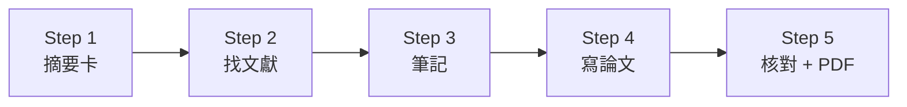

# 單元 06：研究論文處理 — 從分析結果到 arXiv 論文

> 🌐 **語言**：[English](README.md) | 繁體中文

上一單元在國網 HPC 上跑完 QIIME 2 分析，得到三個問題的答案和一整套數據。這個單元帶你和 AI Agent 一起，把這些結果寫成一篇**有引用的英文論文**：

**讀摘要卡 → 找文獻 → 做筆記 → 寫論文 → 核對並輸出 PDF**

全程在自己電腦的資料夾裡完成，不需要 Zotero 或 NotebookLM，也不需要寫程式。

> 📥 **本單元上課簡報**：[下載 06-research-papers.pptx](https://github.com/gemini960114/ai-workshop-research/raw/main/PPTX/06-research-papers.pptx)（23 頁，含講者備註）

> 🎬 **本單元教學影片**：[單元 06｜研究論文處理](https://youtu.be/fyyZEMmqQjY)（YouTube，6 分 37 秒，附[繁體中文字幕](https://github.com/gemini960114/ai-workshop-research/blob/main/movies/06-research-papers.zh-TW.srt)）

> 📂 **這是參考答案資料夾**：照本手冊試跑一次的完整產出（文獻、筆記、比較表、論文與 `main.pdf`），試跑的對話紀錄在 [`test-run-conversation.txt`](test-run-conversation.txt)。練習請使用 [`06-ai-workshop-research-papers/`](../06-ai-workshop-research-papers/)。

> ⚠️ 本單元產出的是**寫作練習用的論文草稿**，不能直接投稿。真的要投稿時，所有數字和引用都要由作者本人核對，並依期刊規定說明 AI 的使用。

| 步驟 | 內容 | 預估時間 |
| :--- | :--- | :---: |
| **準備** | [安裝工具、開啟資料夾](#準備) | 5 分鐘 |
| **Step 1** | [讀研究摘要卡](#step-1讀研究摘要卡) | 5 分鐘 |
| **Step 2** | [找文獻，建立文獻庫](#step-2找文獻建立文獻庫) | 15 分鐘 |
| **Step 3** | [做筆記、文獻比較表](#step-3做筆記文獻比較表) | 15 分鐘 |
| **Step 4** | [依序寫論文](#step-4依序寫論文) | 30 分鐘 |
| **Step 5** | [核對引用、輸出 PDF / Overleaf](#step-5核對引用輸出-pdf--overleaf) | 15 分鐘 |



| 步驟 | 為什麼要做 |
|---|---|
| 讀摘要卡 | 先對齊論文的方向：要回答什麼問題、答案是什麼 |
| 找文獻 | 論文要交代前人做過什麼，研究限制也要有文獻依據 |
| 做筆記、比較表 | 抄下可以引用的原文和頁碼；看清楚別人做了什麼、我們還缺什麼 |
| 寫論文 | 依序寫方法、結果、前言、討論、摘要、標題 |
| 核對、輸出 | 每個引用和數字都追得到出處，再輸出 PDF |

---

## 準備

### 需要的工具

| 工具 | 用途 | 說明 |
|---|---|---|
| **Antigravity**（或 Claude Code） | 和 AI Agent 對話 | 單元 01 已安裝 |
| **uv**（Python） | 執行搜尋、收錄文獻、檢查論文的小程式 | 單元 01 已安裝；uv 會自動準備 Python，畫圖需要的套件 AI 會自動安裝 |
| **LaTeX 或 Overleaf**（二選一） | 把論文排版成 PDF | 有 LaTeX（例如 [TinyTeX](https://yihui.org/tinytex/)）就在本機編譯；沒有的話，註冊免費的 [Overleaf](https://www.overleaf.com) 帳號 |

在 Antigravity 選 **File → Open Folder**，開啟本資料夾。

### 資料夾裡已經有的東西

| 位置 | 內容 |
|---|---|
| `manuscript/00-research-brief.md` | ★ **研究摘要卡**：三個問題、答案、關鍵數字（附來源檔）、研究限制、搜尋關鍵字 |
| `data/tables/` | 上一單元抽出的關鍵數字，**論文所有數字的唯一來源** |
| `data/figures/` | 分析報告的 8 張圖（寫 Results 時參考，論文圖依表格重畫） |
| `data/QIIME2_Analysis_Report.pdf` | AI 產出的分析報告（數字正確，但用詞過強，只當參考） |
| `data/Qiime2_Pipeline.sh` | 分析腳本：Methods 要用的軟體版本與參數 |
| `AGENTS.md` | AI 要遵守的規則：數字只能從 `data/tables/` 讀、只能引用文獻庫裡的論文、用詞要符合證據 |
| `.agents/skills/`、`.claude/skills/` | 4 個 skill（Antigravity 用前者，Claude Code 用後者，內容相同） |

### 什麼是研究摘要卡

`manuscript/00-research-brief.md` 把上一單元的分析成果整理成一頁重點，讓 AI 一開始就知道這篇論文要講什麼：

| 區塊 | 內容 |
|---|---|
| 三個研究問題 | Q1 移植過程中菌相怎麼變化、Q2 兩組有沒有不同、Q3 哪些菌跟著時間起落 |
| 各自的答案 | 豐富度大幅下降；縱向模型中 auto-FMT 組下降較慢（p = 0.016）；腸球菌科、毛螺菌科 |
| 研究限制 | 24 位病人、LME 未收斂、時間跨過 FMT 前後、單次稀釋抽樣、檢體不獨立、預測的是時間不是療效 |
| 數字來源 | 每個數字都標出來自 `data/tables/` 的哪個檔案 |
| 搜尋關鍵字 | 每個限制對應一組關鍵字，Step 2 直接拿來搜尋 |

> 💡 換成自己的研究資料時，沒有現成的摘要卡，可以請 AI 從自己的結果整理一份：「請根據 data/tables/ 的結果，整理一份研究摘要卡，包含問題、答案、數字來源、研究限制和搜尋關鍵字，存成 manuscript/00-research-brief.md。」

### data/tables/ 裡有什麼

上一單元在國網 HPC 上的分析成果，共 13 個檔案，依檔名編號分組。**論文裡的每一個數字，都要從這裡讀。**

| 編號 | 檔案 | 內容 |
|---|---|---|
| 00 | `00_filtering_funnel.tsv` | 篩選流程：每一步剩多少檢體、ASV、讀序 |
| 01 | `01_dada2_stats.tsv`、`01_demux_per_sample_counts.tsv` | 上游 41 個示範檢體的 DADA2 去噪統計、每個檢體的讀序數 |
| 02 | `02_kruskal_*.tsv`（5 個） | Kruskal-Wallis 檢定：兩組、移植時期、FMT 時期、幹細胞來源、糞便性狀 |
| 03 | `03_lme_model_results.tsv`、`03_lme_model_summary.tsv` | 縱向模型（LME）的係數、信賴區間與模型摘要（含 `Converged: No`） |
| 04 | `04_rf_accuracy.tsv`、`04_rf_feature_importance.tsv` | 隨機森林預測移植後週數的準確度、各菌群的重要性 |
| 05 | `05_pcoa_proportion_explained.tsv` | 4 種 Beta 多樣性距離的 PCoA 解釋變異 |

### 本單元用到的 skill

| skill | 做什麼 | 在哪一步用 |
|---|---|---|
| `arxiv` | 搜尋 arXiv 論文 | Step 2 |
| `paper-library` | 下載 PDF、整理檔名、寫進書目 `references.bib` | Step 2 |
| `research-paper-writing` | 論文段落與章節的寫作原則 | Step 4 |
| `arxiv-preprint` | 論文版型、檢查、編譯、打包 | Step 4–5 |

Step 1（讀摘要卡）和 Step 3（做筆記）**不需要 skill**，AI 直接讀檔案和 PDF。

因為 `AGENTS.md` 和 skill 已經規定好細節，下面的 Prompt 都可以寫得很短。

---

## Step 1：讀研究摘要卡

上一單元已經回答了三個問題，這裡先讓 AI 讀懂手上有什麼。這一步不需要 skill。

### 📋 請複製以下指令貼給 AI Agent：

```text
請閱讀 manuscript/00-research-brief.md，並對照 data/tables/ 確認數字，用白話告訴我：這篇論文要回答什麼問題、答案是什麼、有哪些限制、要去找哪些文獻。
```

### 你應該會看到

| 問題 | 答案 |
|---|---|
| Q1 移植過程中，腸道菌相怎麼變化？ | 豐富度大幅下降，腸球菌趁機霸占 |
| Q2 auto-FMT 組和對照組不同嗎？ | 混在一起比沒有差別（p = 0.256）；縱向模型中 auto-FMT 組下降得比較慢（p = 0.016） |
| Q3 哪些菌跟著移植時間起落？ | 主要是腸球菌科和毛螺菌科 |

以及 6 個研究限制（24 位病人、LME 未收斂、時間跨過 FMT 前後…）和對應的搜尋關鍵字。

> 💡 論文的主軸：**同一份資料，混在一起比看不出差別，縱向模型才看得到斜率差。**論文定位是「分析方法的比較」，不宣稱療效。

---

## Step 2：找文獻，建立文獻庫

### 2-1 搜尋

### 📋 請複製以下指令貼給 AI Agent：

```text
請用 arxiv skill，依照 manuscript/00-research-brief.md 的搜尋關鍵字找相關論文，列出候選清單給我挑選，並用 ★ 標出最推薦的幾篇，先不要下載。
```

AI 會列出候選論文和每篇跟我們研究的關係。**由你決定要收哪幾篇**。

> 💡 如果結果混進不相關的論文，請 AI「改用 `abs:microbiome AND abs:longitudinal` 這種語法重新搜尋」。

### 2-2 收進文獻庫

### 📋 請複製以下指令貼給 AI Agent：

```text
請用 paper-library skill 收錄所有標註 ★ 推薦的 arXiv 論文。
```

（也可以指定編號，例如「收錄第 1、3、5 篇」。）

### 2-3 用 DOI 登錄期刊論文

arXiv 上找不到的期刊論文，例如原始臨床試驗、QIIME 2、DADA2、SILVA，用 DOI 登錄：

### 📋 請複製以下指令貼給 AI Agent：

```text
請用 paper-library skill，用 DOI 登錄 Taur 2018 原始試驗、QIIME 2、DADA2、SILVA 這 4 篇論文。
```

> ⚠️ **這一步不要跳過。** 少了這 4 篇，論文就沒有引用原始臨床試驗和分析工具，投稿時一定會被要求補上。登錄後也要為它們寫筆記（標註「僅讀摘要」），引用時只能用摘要寫到的內容。

### 你應該會看到

| 位置 | 內容 |
|---|---|
| `papers/` | 下載的 PDF，檔名自動整理成「作者_年份_標題」 |
| `library/references.bib` | 書目清單，寫論文時只能從這裡引用 |
| `library/download-log.md` | 下載紀錄：哪天、用什麼關鍵字找到哪一篇 |

試跑結果：收錄 8 篇 arXiv 論文（FMT 植入評估、縱向菌相模型、重複測量、稀釋爭議、組成資料五個面向），加上 4 篇 DOI 期刊論文。

---

## Step 3：做筆記、文獻比較表

這一步不需要 skill，AI 直接讀 PDF。

### 📋 請複製以下指令貼給 AI Agent：

```text
請讀 papers/ 的每篇論文，在 library/notes/ 幫每篇寫一份筆記，要附上可以引用的原文和頁碼。只有 DOI、沒有 PDF 的論文，改讀摘要並在筆記標註「僅讀摘要」。
```

筆記寫完後，請 AI 把所有文獻放在一起比較：

```text
請根據 library/notes/ 的筆記和 manuscript/00-research-brief.md 的研究限制，整理一份文獻比較表：別人做了什麼、我們缺什麼，存成 library/literature-matrix.md。
```

### 你應該會看到

- 每篇論文一份筆記（`library/notes/<citekey>.md`），內容包括書目、一句話摘要、研究問題、方法、主要發現、和我們研究的關係，以及最重要的「**可引用的原文**」：逐字抄下原文並標註頁碼。之後論文裡的每個引用都要能對回這裡。
- 比較表：每個研究限制，有哪些文獻討論過、建議了什麼更好的做法。這會直接用在 Discussion。

試跑結果：6 個限制都找到對應的解法，例如 LME 未收斂 → SAEM 演算法（Barrera 2025）；單次稀釋 → q2-boots 多重抽樣（Raspet 2024）、McMurdie 2013；檢體不獨立 → LinDA-LMM（Zhou 2021）；時間跨過 FMT 前後 → 時變係數模型（Fontaine 2026）。

---

## Step 4：依序寫論文

### 寫作順序 ≠ 閱讀順序

| 順序 | 章節 | 為什麼這時候寫 |
|:---:|---|---|
| 1 | 資料與方法 | 你做了什麼，最確定、最好寫 |
| 2 | 結果 | 數據呈現了什麼，只描述事實，不解釋 |
| 3 | 前言 | 結果確定了，才知道要怎麼鋪陳背景、引用哪些前人研究 |
| 4 | 討論（含結論） | 對照前人研究解釋結果，並寫出研究限制 |
| 5 | 摘要 | 全文完成後才濃縮得出來 |
| 6 | 標題 | 最後依實際內容決定 |

### 4-1 建立論文架構

### 📋 請複製以下指令貼給 AI Agent：

```text
請用 arxiv-preprint skill 在 manuscript/ 建立英文論文架構，每一節一個檔案放在 sections/。
```

### 你應該會看到

先有骨架，再一節一節填內容：

| 檔案 | 內容 |
|---|---|
| `main.tex` | 主控檔，依閱讀順序 `\input` 各節：標題 → 摘要 → 前言 → 方法 → 結果 → 討論 → 聲明 |
| `sections/01-methods.tex` … `07-declarations.tex` | 7 個只有大綱的空白章節檔，檔名編號就是寫作順序 |
| `arxiv.sty`、`fancyhdr.sty`、`figures/` | 版型檔與圖檔資料夾 |
| `main.pdf`、`check-report.md` | 一份 2 頁的空白 PDF，以及還沒替換的佔位文字清單 |

空白章節檔只有大綱，例如 `01-methods.tex` 的骨架大致是：

```latex
% sections/01-methods.tex — 寫作順序 1
\section{Methods}
\subsection{Data source and participants}
  % 試驗、篩選條件 ← data/tables/00_filtering_funnel.tsv
\subsection{Processing}
  % QIIME 2 版本、DADA2、SILVA ← data/Qiime2_Pipeline.sh
\subsection{Statistical analysis}
  % Kruskal-Wallis、LME、隨機森林
```

（實際小節名稱可能不同；寫 Methods 時 AI 會依資料改寫，試跑的版本最後是 4 個小節。）

### 4-2 一次寫一節

依序貼上以下 Prompt。**每寫完一節，先看過再寫下一節。**

```text
請參考 research-paper-writing skill，用英文寫 Methods。
```

```text
請寫 Results，只描述數據，不要解釋。需要的圖請依 data/tables/ 重畫。
```

```text
請寫 Introduction。
```

```text
請依照文獻比較表寫 Discussion，包含研究限制和結論。
```

```text
請寫結構化摘要。
```

```text
請提出 3 個候選標題，說明你推薦哪一個。
```

> 💡 Prompt 這麼短也可以，是因為 `AGENTS.md` 和 skill 已經規定好：數字一律從 `data/tables/` 讀、只能引用文獻庫裡的論文、24 位病人的研究不能寫「證明有效」。你只需要告訴 AI「現在寫哪一節」。

### 你應該會看到

| 檔案 | 試跑結果 |
|---|---|
| `01-methods.tex` | 資料來源與五階段篩選、DADA2 與 SILVA、多樣性與 Kruskal-Wallis、LME 與隨機森林；參數取自 `Qiime2_Pipeline.sh` |
| `02-results.tex` | Table 1 篩選流程、Table 2 LME 係數；只描述數據 |
| `figures/`、`plot_figures.py` | 依 `data/tables/` 重畫的 4 張圖：篩選與 QC、多樣性與 PCoA、LME 軌跡、隨機森林重要性 |
| `03-introduction.tex` | 臨床問題 → 縱向分析的方法挑戰 → 三個研究問題 |
| `04-discussion.tex` | 主要發現、與文獻比較、6 個限制與改進方法、結論 |
| `05-abstract.tex` | 結構化摘要，1,910 字元（上限 1,920） |
| `06-title.tex` | 3 個候選標題與推薦理由 |

### Introduction 是引用最多的一節

試跑的前言引用了文獻庫 12 篇中的 9 篇：一句背景、一個出處，最後帶出三個研究問題。例如這一句：

> Second, standard diversity workflows commonly normalize library sizes via a single random subsampling without replacement (rarefying) to a fixed read threshold, a practice that **discards valid sequencing reads** and excludes low-depth specimens … `\citep{mcmurdie2013waste, raspet2024facilitating}`.

這個說法要能對回筆記 `library/notes/mcmurdie2013waste.md` 逐字抄下的原文（p. 3）：

> "… rarefying biological count data is statistically inadmissible because it requires the omission of available valid data."

Step 5-2 的逐句核對，就是對每一個引用都做這件事。

### 4-3 定稿標題、補上聲明

```text
採用候選標題 1。請補上論文最後的聲明段落，作者貢獻、利益衝突、經費先留空，由作者填寫。
```

> ⚠️ 作者貢獻、利益衝突、經費**只能由作者本人提供**，不要讓 AI 代寫。
>
> ⚠️ 試跑時 AI 在倫理段寫了「二次分析公開資料，不需另外 IRB 審查」。這是 AI 自己下的判斷，**必須由作者確認**。

---

## Step 5：核對引用、輸出 PDF / Overleaf

### 5-1 檢查並輸出 PDF

### 📋 請複製以下指令貼給 AI Agent：

```text
請用 arxiv-preprint skill 檢查並編譯論文，告訴我檢查結果。
```

本機已安裝 LaTeX 的話，也可以直接請 AI 用本機編譯：

```text
請先用 which pdflatex 確認本機的 LaTeX，再用本機的 pdflatex + bibtex 直接編譯 manuscript/main.tex 產出 main.pdf，有錯誤就修正後重新編譯，並告訴我 PDF 有幾頁、有沒有警告。
```

AI 會執行 `build.py`，自動檢查：引用的論文都在文獻庫、圖檔都找得到、摘要沒超過 arXiv 上限（1,920 字元）、沒有留下待填寫的地方。結果寫在 `manuscript/check-report.md`，看到 ❌ 就請 AI 修正後再檢查一次。

有 LaTeX 的話會產出 `manuscript/main.pdf`；沒有的話會產出 `manuscript/overleaf.zip`。

### 5-2 逐句核對引用與數字

`build.py` 只能確認「引用的論文存在」。**論文裡寫的那句話，原文真的有這樣說嗎？數字真的對嗎？**這要逐句核對：

### 📋 請複製以下指令貼給 AI Agent：

```text
請逐句核對論文中的每一個引用，原文有沒有支持這句話；再把論文裡的每一個數字對回 data/tables/。整理成 manuscript/citation-check.md。
```

### 你應該會看到

| 檔案 | 試跑結果 |
|---|---|
| `check-report.md` | 12 篇引用都在文獻庫、4 張圖、摘要 1,910 字元、0 個編譯警告；唯一的 ❌ 是保留給作者填寫的 `[To be completed]`（預期中） |
| `citation-check.md` | 26 處引用逐句對照筆記原文、22 組數字對回 tables；**抓到 2 處寫過頭的引用並修正**，另刪除 1 句沒有文獻支持的說法 |
| `main.pdf` | 12 頁英文論文、12 篇參考文獻，0 錯誤、0 未定義引用 |
| `overleaf.zip`、`arxiv-submission.tar.gz` | Overleaf 與 arXiv 上傳用的打包檔（後者已含 `.bbl`） |

### main.pdf 是什麼格式

- **arXiv 預印本版型**（[kourgeorge/arxiv-style](https://github.com/kourgeorge/arxiv-style)，MIT 授權）：LaTeX `article` 加 `arxiv.sty`，用 pdfLaTeX 編譯。
- 單欄排版；標題置中、小型大寫字；頁首有短標題與「Preprint」字樣。
- 結構：Abstract（Background / Methods / Results / Conclusions）→ Introduction → Methods → Results → Discussion → Declarations → References。
- 引用為數字編號 `[1, 2]`（natbib + plainnat）；要改成作者年份格式，只要改 `main.tex` 的一行。
- 這是預印本格式，不是特定期刊的格式；要投稿時再換成該期刊的 LaTeX 範本。

### 5-3 沒有 LaTeX：用 Overleaf

1. 登入 [Overleaf](https://www.overleaf.com)，點 **New Project → Upload Project**，選 `manuscript/overleaf.zip`。
2. 左上角選單 → **Compiler** 選 **pdfLaTeX** → 按 **Recompile**。
3. 要上 arXiv 時，記得附上參考文獻的 `.bbl` 檔：在 Overleaf 下載 `output.bbl`，改名為 `main.bbl` 放進 `manuscript/`，再執行一次 5-1。

> ⚠️ **練習時請不要真的上傳 arXiv。** arXiv 的論文無法刪除，只能撤回。

---

## 常見問題

**Q1：arXiv 找不到我要的論文怎麼辦？**
arXiv 以統計、資訊類論文為主，臨床論文大多不在上面。用 DOI 登錄書目即可，PDF 請從學校圖書館或期刊網站下載，再用 paper-library 的 `--pdf` 收錄。

**Q2：只讀過摘要的論文可以引用嗎？**
可以，但只能引用摘要裡寫到的內容。

**Q3：AI 寫的數字和摘要卡不一樣？**
以 `data/tables/` 為準。請 AI「把這個數字對回 data/tables/ 的原始檔」。

**Q4：Overleaf 編譯失敗？**
確認 Compiler 選的是 **pdfLaTeX**。還是失敗的話，把錯誤訊息貼給 AI 修正。

---

## 資料夾內容

```
06-ai-workshop-research-papers-answer/
├── README.md                  本手冊
├── AGENTS.md                  AI 要遵守的規則
├── .agents/skills/            4 個 skill（Antigravity 用）
├── .claude/skills/            4 個 skill（Claude Code 用，內容相同）
├── data/
│   ├── tables/                關鍵數字（所有數字的來源）
│   ├── figures/               分析報告的 8 張圖
│   ├── QIIME2_Analysis_Report.pdf   AI 分析報告（參考用）
│   └── Qiime2_Pipeline.sh     分析腳本（Methods 用）
├── papers/                    Step 2：下載的論文 PDF
├── library/
│   ├── references.bib         Step 2：書目清單
│   ├── download-log.md        Step 2：下載紀錄
│   ├── notes/                 Step 3：每篇論文的筆記
│   └── literature-matrix.md   Step 3：文獻比較表
└── manuscript/
    ├── 00-research-brief.md   Step 1：研究摘要卡
    ├── main.tex  sections/  figures/   Step 4：論文
    └── main.pdf  check-report.md  citation-check.md  overleaf.zip   Step 5
```
