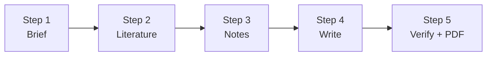

# Unit 06: Research Paper Workflow — From Analysis Results to an arXiv Paper

> 🌐 **Language**: English | [繁體中文](README.zh-TW.md)

In the previous unit, you ran a QIIME 2 analysis on the NCHC (National Center for High-performance Computing) HPC and got answers to three questions along with a full set of data. In this unit, you and an AI Agent will turn those results into an **English paper with citations**:

**Read the research brief → Find literature → Take notes → Write the paper → Verify and export to PDF**

Everything happens in a folder on your own computer. No Zotero or NotebookLM is needed, and no coding is required.

> 📥 **Unit Slides**: [Download 06-research-papers.en.pptx](https://github.com/gemini960114/ai-workshop-research/raw/main/PPTX/06-research-papers.en.pptx) (23 slides, with speaker notes; [Chinese version](https://github.com/gemini960114/ai-workshop-research/raw/main/PPTX/06-research-papers.pptx))

> 🎬 **Tutorial Video**: [Unit 06 | Research Paper Workflow](https://youtu.be/o253sy87788) (YouTube, 6 min 57 sec, English narration with English subtitles; [Chinese version](https://youtu.be/fyyZEMmqQjY))

> ⚠️ What this unit produces is a **draft paper for writing practice** and must not be submitted as is. If you actually intend to submit, every number and citation must be verified by the authors themselves, and the use of AI must be disclosed according to the journal's policy.

| Step | Content | Est. Time |
| :--- | :--- | :---: |
| **Preparation** | [Install Tools and Open the Folder](#preparation) | 5 min |
| **Step 1** | [Read the Research Brief](#step-1-read-the-research-brief) | 5 min |
| **Step 2** | [Find Literature and Build a Library](#step-2-find-literature-and-build-a-library) | 15 min |
| **Step 3** | [Take Notes and Build a Literature Matrix](#step-3-take-notes-and-build-a-literature-matrix) | 15 min |
| **Step 4** | [Write the Paper Section by Section](#step-4-write-the-paper-section-by-section) | 30 min |
| **Step 5** | [Verify Citations, Export PDF / Overleaf](#step-5-verify-citations-export-pdf--overleaf) | 15 min |



| Step | Why It Matters |
|---|---|
| Read the brief | Align on the paper's direction first: what questions it answers and what the answers are |
| Find literature | A paper must explain what others have done before, and the study's limitations need literature support too |
| Notes and matrix | Record quotable passages with page numbers; see clearly what others have done and what we are still missing |
| Write the paper | Write in order: Methods, Results, Introduction, Discussion, Abstract, Title |
| Verify and export | Every citation and number can be traced back to its source, then export to PDF |

---

## Preparation

### Required Tools

| Tool | Purpose | Notes |
|---|---|---|
| **Antigravity** (or Claude Code) | Chat with the AI Agent | Installed in Unit 01 |
| **uv** (Python) | Runs the small programs that search, collect literature, and check the paper | Installed in Unit 01; uv sets up Python automatically, and the AI installs any plotting packages it needs |
| **LaTeX or Overleaf** (either one) | Typesets the paper into a PDF | If you have LaTeX (e.g., [TinyTeX](https://yihui.org/tinytex/)), compile locally; otherwise, sign up for a free [Overleaf](https://www.overleaf.com) account |

In Antigravity, choose **File → Open Folder** and open this folder.

### What's Already in the Folder

| Location | Content |
|---|---|
| `manuscript/00-research-brief.md` | ★ **Research brief**: three questions, answers, key numbers (with source files), study limitations, and search keywords |
| `data/tables/` | Key numbers extracted in the previous unit — **the single source of every number in the paper** |
| `data/figures/` | The 8 figures from the analysis report (reference for writing Results; the paper's figures are redrawn from the tables) |
| `data/QIIME2_Analysis_Report.pdf` | The AI-generated analysis report (numbers are correct but the wording is too strong; for reference only) |
| `data/Qiime2_Pipeline.sh` | Analysis script: software versions and parameters needed for Methods |
| `AGENTS.md` | Rules the AI must follow: numbers may only be read from `data/tables/`, only papers in the library may be cited, and wording must match the evidence |
| `.agents/skills/`, `.claude/skills/` | 4 skills (Antigravity uses the former, Claude Code the latter; contents are identical) |

### What Is the Research Brief?

`manuscript/00-research-brief.md` condenses the previous unit's analysis results into a one-page summary, so the AI knows from the start what this paper is about:

| Section | Content |
|---|---|
| Three research questions | Q1 How does the gut microbiota change during transplantation? Q2 Do the two groups differ? Q3 Which taxa rise and fall with time? |
| Answers to each | Richness drops sharply; in the longitudinal model the auto-FMT group declines more slowly (p = 0.016); Enterococcaceae and Lachnospiraceae |
| Study limitations | 24 patients, LME did not converge, time spans before and after FMT, single rarefaction, non-independent samples, the model predicts time rather than treatment efficacy |
| Number sources | Each number is tagged with the file in `data/tables/` it comes from |
| Search keywords | Each limitation maps to a set of keywords, used directly for searching in Step 2 |

> 💡 When you switch to your own research data, there won't be a ready-made brief. You can ask the AI to build one from your own results: "Based on the results in data/tables/, put together a research brief including the questions, answers, number sources, study limitations, and search keywords, and save it as manuscript/00-research-brief.md."

### What's in data/tables/

The analysis results from the previous unit on the NCHC HPC: 13 files in total, grouped by the number prefix in their file names. **Every number in the paper must be read from here.**

| Prefix | File | Content |
|---|---|---|
| 00 | `00_filtering_funnel.tsv` | Filtering funnel: how many samples, ASVs, and reads remain after each step |
| 01 | `01_dada2_stats.tsv`, `01_demux_per_sample_counts.tsv` | DADA2 denoising statistics for the 41 upstream demo samples, and read counts per sample |
| 02 | `02_kruskal_*.tsv` (5 files) | Kruskal-Wallis tests: two groups, transplant period, FMT period, stem cell source, stool consistency |
| 03 | `03_lme_model_results.tsv`, `03_lme_model_summary.tsv` | Coefficients, confidence intervals, and model summary of the longitudinal model (LME) (including `Converged: No`) |
| 04 | `04_rf_accuracy.tsv`, `04_rf_feature_importance.tsv` | Random forest accuracy in predicting weeks post-transplant, and the importance of each taxon |
| 05 | `05_pcoa_proportion_explained.tsv` | PCoA variance explained for 4 beta diversity distances |

### Skills Used in This Unit

| Skill | What It Does | Used In |
|---|---|---|
| `arxiv` | Searches arXiv papers | Step 2 |
| `paper-library` | Downloads PDFs, tidies file names, writes to the bibliography `references.bib` | Step 2 |
| `research-paper-writing` | Writing principles for paragraphs and sections | Step 4 |
| `arxiv-preprint` | Paper template, checks, compilation, packaging | Steps 4–5 |

Step 1 (reading the brief) and Step 3 (taking notes) **do not need a skill**; the AI reads the files and PDFs directly.

Because `AGENTS.md` and the skills already specify the details, all of the prompts below can be kept very short.

---

## Step 1: Read the Research Brief

The previous unit already answered three questions; here we first let the AI understand what we have on hand. This step does not need a skill.

### 📋 Copy the following prompt and paste it to the AI Agent:

```text
Please read manuscript/00-research-brief.md, cross-check the numbers against data/tables/, and tell me in plain language: what questions this paper answers, what the answers are, what the limitations are, and what literature we need to find.
```

### What You Should See

| Question | Answer |
|---|---|
| Q1 How does the gut microbiota change during transplantation? | Richness drops sharply, and Enterococcus takes over |
| Q2 Does the auto-FMT group differ from the control group? | Pooled comparison shows no difference (p = 0.256); in the longitudinal model the auto-FMT group declines more slowly (p = 0.016) |
| Q3 Which taxa rise and fall with transplant time? | Mainly Enterococcaceae and Lachnospiraceae |

Plus 6 study limitations (24 patients, LME did not converge, time spans before and after FMT…) and the corresponding search keywords.

> 💡 The paper's central message: **With the same data, a pooled comparison shows no difference, but a longitudinal model reveals a difference in slopes.** The paper is positioned as a "comparison of analysis methods" and makes no claims about treatment efficacy.

---

## Step 2: Find Literature and Build a Library

### 2-1 Search

### 📋 Copy the following prompt and paste it to the AI Agent:

```text
Please use the arxiv skill to search for related papers using the search keywords in manuscript/00-research-brief.md. List the candidates for me to choose from, mark the most recommended ones with ★, and don't download anything yet.
```

The AI will list candidate papers and how each relates to our study. **You decide which ones to collect.**

> 💡 If unrelated papers show up in the results, ask the AI to "search again using syntax like `abs:microbiome AND abs:longitudinal`."

### 2-2 Add to the Library

### 📋 Copy the following prompt and paste it to the AI Agent:

```text
Please use the paper-library skill to add all the arXiv papers marked ★ as recommended.
```

(You can also specify numbers, e.g., "Add papers 1, 3, and 5.")

### 2-3 Register Journal Papers by DOI

For journal papers that aren't on arXiv — such as the original clinical trial, QIIME 2, DADA2, and SILVA — register them by DOI:

### 📋 Copy the following prompt and paste it to the AI Agent:

```text
Please use the paper-library skill to register these 4 papers by DOI: the original Taur 2018 trial, QIIME 2, DADA2, and SILVA.
```

> ⚠️ **Don't skip this step.** Without these 4 papers, the paper won't cite the original clinical trial or the analysis tools, and you will certainly be asked to add them at submission. After registering them, write notes for them too (marked "abstract only" (僅讀摘要)), and when citing them, only use what is stated in the abstract.

### What You Should See

| Location | Content |
|---|---|
| `papers/` | Downloaded PDFs, with file names automatically tidied into "Author_Year_Title" |
| `library/references.bib` | The bibliography; the paper may only cite from here |
| `library/download-log.md` | Download log: which paper was found on which date with which keywords |

Trial-run result: 8 arXiv papers collected (covering five areas: FMT engraftment assessment, longitudinal microbiome models, repeated measures, the rarefaction debate, and compositional data), plus 4 DOI journal papers.

---

## Step 3: Take Notes and Build a Literature Matrix

This step does not need a skill; the AI reads the PDFs directly.

### 📋 Copy the following prompt and paste it to the AI Agent:

```text
Please read each paper in papers/ and write a note for each one in library/notes/, including quotable passages with page numbers. For papers that only have a DOI and no PDF, read the abstract instead and mark the note "abstract only" (僅讀摘要).
```

Once the notes are done, ask the AI to compare all the literature side by side:

```text
Based on the notes in library/notes/ and the study limitations in manuscript/00-research-brief.md, put together a literature matrix: what others have done and what we are missing. Save it as library/literature-matrix.md.
```

### What You Should See

- One note per paper (`library/notes/<citekey>.md`), covering the bibliographic entry, a one-sentence summary, research question, methods, main findings, relevance to our study, and most importantly the "**quotable passages**": verbatim quotes from the original with page numbers. Every citation in the paper must later be traceable back to here.
- The matrix: for each study limitation, which papers discuss it and what better approaches they suggest. This feeds directly into the Discussion.

Trial-run result: solutions were found for all 6 limitations, for example LME did not converge → SAEM algorithm (Barrera 2025); single rarefaction → q2-boots multiple subsampling (Raspet 2024), McMurdie 2013; non-independent samples → LinDA-LMM (Zhou 2021); time spans before and after FMT → time-varying coefficient model (Fontaine 2026).

---

## Step 4: Write the Paper Section by Section

### Writing Order ≠ Reading Order

| Order | Section | Why Write It Now |
|:---:|---|---|
| 1 | Methods | What you did — the most certain and easiest to write |
| 2 | Results | What the data show — describe facts only, no interpretation |
| 3 | Introduction | Only once the results are settled do you know how to frame the background and which prior work to cite |
| 4 | Discussion (including Conclusions) | Interpret the results against prior work and state the study limitations |
| 5 | Abstract | Can only be distilled once the full text is done |
| 6 | Title | Decided last, based on the actual content |

### 4-1 Set Up the Paper Skeleton

### 📋 Copy the following prompt and paste it to the AI Agent:

```text
Please use the arxiv-preprint skill to set up an English paper skeleton in manuscript/, with one file per section under sections/.
```

### What You Should See

The skeleton comes first, then content is filled in section by section:

| File | Content |
|---|---|
| `main.tex` | Main file that `\input`s each section in reading order: Title → Abstract → Introduction → Methods → Results → Discussion → Declarations |
| `sections/01-methods.tex` … `07-declarations.tex` | 7 empty section files containing only outlines; the number in each file name is the writing order |
| `arxiv.sty`, `fancyhdr.sty`, `figures/` | Template files and figure folder |
| `main.pdf`, `check-report.md` | A 2-page blank PDF, and a list of placeholders not yet replaced |

The empty section files contain only an outline. For example, the skeleton of `01-methods.tex` looks roughly like this:

```latex
% sections/01-methods.tex — writing order 1
\section{Methods}
\subsection{Data source and participants}
  % trial, filtering criteria ← data/tables/00_filtering_funnel.tsv
\subsection{Processing}
  % QIIME 2 version, DADA2, SILVA ← data/Qiime2_Pipeline.sh
\subsection{Statistical analysis}
  % Kruskal-Wallis, LME, random forest
```

(Actual subsection names may differ; when writing Methods the AI rewrites them based on the data. In the trial run the final version had 4 subsections.)

### 4-2 Write One Section at a Time

Paste the following prompts in order. **After each section is written, review it before moving on to the next.**

```text
Please refer to the research-paper-writing skill and write the Methods in English.
```

```text
Please write the Results, describing only the data without interpretation. Redraw any needed figures from data/tables/.
```

```text
Please write the Introduction.
```

```text
Please write the Discussion based on the literature matrix, including the study limitations and conclusions.
```

```text
Please write a structured abstract.
```

```text
Please propose 3 candidate titles and explain which one you recommend.
```

> 💡 Prompts this short work because `AGENTS.md` and the skills already specify that numbers are always read from `data/tables/`, only papers in the library may be cited, and a 24-patient study must not claim to "prove efficacy." All you need to tell the AI is "which section to write now."

### What You Should See

| File | Trial-Run Result |
|---|---|
| `01-methods.tex` | Data source and five-stage filtering, DADA2 and SILVA, diversity and Kruskal-Wallis, LME and random forest; parameters taken from `Qiime2_Pipeline.sh` |
| `02-results.tex` | Table 1 filtering funnel, Table 2 LME coefficients; data description only |
| `figures/`, `plot_figures.py` | 4 figures redrawn from `data/tables/`: filtering and QC, diversity and PCoA, LME trajectories, random forest importance |
| `03-introduction.tex` | Clinical problem → methodological challenges of longitudinal analysis → three research questions |
| `04-discussion.tex` | Main findings, comparison with the literature, 6 limitations and ways to improve, conclusions |
| `05-abstract.tex` | Structured abstract, 1,910 characters (limit 1,920) |
| `06-title.tex` | 3 candidate titles and the reason for the recommendation |

### The Introduction Cites the Most

In the trial run, the Introduction cited 9 of the 12 papers in the library: one background statement, one source, ending with the three research questions. For example, this sentence:

> Second, standard diversity workflows commonly normalize library sizes via a single random subsampling without replacement (rarefying) to a fixed read threshold, a practice that **discards valid sequencing reads** and excludes low-depth specimens … `\citep{mcmurdie2013waste, raspet2024facilitating}`.

This claim must be traceable to the verbatim quote recorded in the note `library/notes/mcmurdie2013waste.md` (p. 3):

> "… rarefying biological count data is statistically inadmissible because it requires the omission of available valid data."

The sentence-by-sentence check in Step 5-2 does exactly this for every citation.

### 4-3 Finalize the Title and Add the Declarations

```text
Use candidate title 1. Please add the declarations section at the end of the paper, leaving author contributions, conflicts of interest, and funding blank for the authors to fill in.
```

> ⚠️ Author contributions, conflicts of interest, and funding **can only be provided by the authors themselves**. Do not let the AI write them.
>
> ⚠️ In the trial run, the AI wrote in the ethics paragraph that "secondary analysis of public data does not require separate IRB review." That is a judgment the AI made on its own and **must be confirmed by the authors**.

---

## Step 5: Verify Citations, Export PDF / Overleaf

### 5-1 Check and Export the PDF

### 📋 Copy the following prompt and paste it to the AI Agent:

```text
Please use the arxiv-preprint skill to check and compile the paper, and tell me the check results.
```

If LaTeX is installed locally, you can also ask the AI to compile directly on your machine:

```text
Please first run which pdflatex to confirm the local LaTeX installation, then use the local pdflatex + bibtex to compile manuscript/main.tex directly into main.pdf. If there are errors, fix them and recompile, then tell me how many pages the PDF has and whether there are any warnings.
```

The AI runs `build.py`, which automatically checks that every cited paper is in the library, every figure file can be found, the abstract doesn't exceed the arXiv limit (1,920 characters), and no placeholders are left unfilled. The results are written to `manuscript/check-report.md`; if you see ❌, ask the AI to fix it and check again.

If you have LaTeX, it produces `manuscript/main.pdf`; otherwise it produces `manuscript/overleaf.zip`.

### 5-2 Verify Citations and Numbers Sentence by Sentence

`build.py` can only confirm that "the cited papers exist." **Does the original source really say what the sentence in the paper claims? Are the numbers really correct?** That requires a sentence-by-sentence check:

### 📋 Copy the following prompt and paste it to the AI Agent:

```text
Please check every citation in the paper sentence by sentence to see whether the original source supports the sentence; then trace every number in the paper back to data/tables/. Compile the results into manuscript/citation-check.md.
```

### What You Should See

| File | Trial-Run Result |
|---|---|
| `check-report.md` | All 12 citations are in the library, 4 figures, abstract 1,910 characters, 0 compilation warnings; the only ❌ is the `[To be completed]` reserved for the authors (expected) |
| `citation-check.md` | 26 citations checked sentence by sentence against the quotes in the notes, 22 sets of numbers traced back to the tables; **2 overstated citations were caught and corrected**, and 1 sentence without literature support was deleted |
| `main.pdf` | 12-page English paper with 12 references, 0 errors, 0 undefined citations |
| `overleaf.zip`, `arxiv-submission.tar.gz` | Packages for uploading to Overleaf and arXiv (the latter already includes the `.bbl`) |

### What Format Is main.pdf?

- **arXiv preprint template** ([kourgeorge/arxiv-style](https://github.com/kourgeorge/arxiv-style), MIT license): LaTeX `article` plus `arxiv.sty`, compiled with pdfLaTeX.
- Single-column layout; centered title in small caps; the header shows a short title and the word "Preprint."
- Structure: Abstract (Background / Methods / Results / Conclusions) → Introduction → Methods → Results → Discussion → Declarations → References.
- Citations are numbered `[1, 2]` (natbib + plainnat); switching to author-year style only requires changing one line in `main.tex`.
- This is a preprint format, not any specific journal's format; when submitting, switch to that journal's LaTeX template.

### 5-3 No LaTeX: Use Overleaf

1. Log in to [Overleaf](https://www.overleaf.com), click **New Project → Upload Project**, and select `manuscript/overleaf.zip`.
2. In the menu at the top left, set **Compiler** to **pdfLaTeX** → click **Recompile**.
3. When uploading to arXiv, remember to include the bibliography's `.bbl` file: download `output.bbl` from Overleaf, rename it to `main.bbl`, put it in `manuscript/`, and run 5-1 again.

> ⚠️ **Do not actually upload to arXiv during practice.** Papers on arXiv cannot be deleted, only withdrawn.

---

## FAQ

**Q1: What if I can't find the paper I need on arXiv?**
arXiv mainly hosts statistics and computer science papers; most clinical papers aren't there. Just register the bibliographic entry by DOI. Download the PDF from your university library or the journal website, then add it with paper-library's `--pdf` option.

**Q2: Can I cite a paper I've only read the abstract of?**
Yes, but you may only cite what is stated in the abstract.

**Q3: The numbers the AI wrote don't match the brief?**
`data/tables/` is the authority. Ask the AI to "trace this number back to the source file in data/tables/."

**Q4: Overleaf compilation fails?**
Make sure the Compiler is set to **pdfLaTeX**. If it still fails, paste the error message to the AI and ask it to fix it.

---

## Folder Contents

```
06-ai-workshop-research-papers/
├── README.md                  This guide
├── AGENTS.md                  Rules the AI must follow
├── .agents/skills/            4 skills (for Antigravity)
├── .claude/skills/            4 skills (for Claude Code, same contents)
├── data/
│   ├── tables/                Key numbers (source of all numbers)
│   ├── figures/               8 figures from the analysis report
│   ├── QIIME2_Analysis_Report.pdf   AI analysis report (for reference)
│   └── Qiime2_Pipeline.sh     Analysis script (for Methods)
├── papers/                    Step 2: downloaded paper PDFs
├── library/
│   ├── references.bib         Step 2: bibliography
│   ├── download-log.md        Step 2: download log
│   ├── notes/                 Step 3: notes for each paper
│   └── literature-matrix.md   Step 3: literature matrix
└── manuscript/
    ├── 00-research-brief.md   Step 1: research brief
    ├── main.tex  sections/  figures/   Step 4: the paper
    └── main.pdf  check-report.md  citation-check.md  overleaf.zip   Step 5
```
